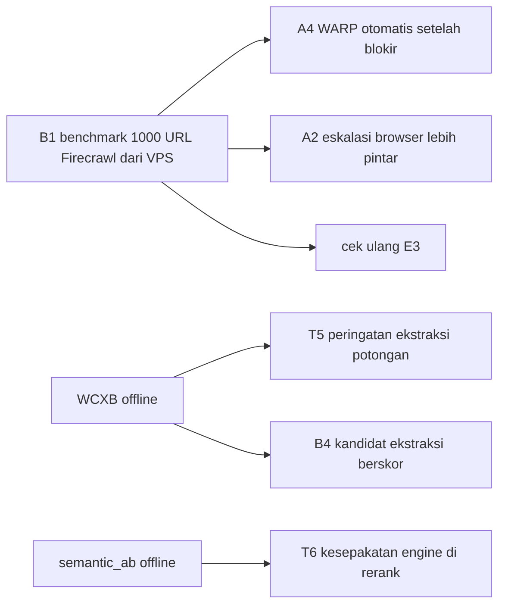

# Studi referensi: server MCP web sejenis Argus (2026-10-04)

> [!NOTE]
> Studi kode, bukan ulasan README. 13 repo di-clone (shallow) dan dibaca oleh 4 agen
> paralel; tidak ada kode referensi yang dijalankan atau di-install. Setiap klaim punya
> bukti `file:line` di repo referensi dan di Argus (rincian ada di laporan agen, ringkasan
> di sini). Satu temuan keamanan sudah diukur di produksi.

## Daftar Isi

- [Repo yang dipelajari](#repo-yang-dipelajari)
- [Gambaran besar](#gambaran-besar)
- [Prioritas 1: keamanan dan bug](#prioritas-1-keamanan-dan-bug)
- [Prioritas 2: kejujuran dan ergonomi agen (adopsi, kecil)](#prioritas-2-kejujuran-dan-ergonomi-agen-adopsi-kecil)
- [Prioritas 3: ukur dulu, baru putuskan](#prioritas-3-ukur-dulu-baru-putuskan)
- [Ditolak (dengan alasan)](#ditolak-dengan-alasan)
- [Klaim pesaing yang tidak terbukti di kode](#klaim-pesaing-yang-tidak-terbukti-di-kode)

## Repo yang dipelajari

| Tema | Repo | Catatan |
|---|---|---|
| Desain tool | `firecrawl/firecrawl-mcp-server` (7.5k), `exa-labs/exa-mcp-server` (5k), `modelcontextprotocol/servers` src/fetch (referensi resmi), `ihor-sokoliuk/mcp-searxng` (1.3k) | pemimpin pasar dan referensi protokol |
| Arsitektur dan ekstraksi | `fastcrw/crw` (Rust, 1.1k), `Anakin-Inc/anakin` (Go, 4.5k), `kindly-web-search-mcp-server` (Python), `hermes-web-search-plus` (Python) | stack self-hosted |
| Anti-bot dan keamanan | `D4Vinci/Scrapling` (BSD-3), `Johell1NS/browser-search` (Camoufox + CloakBrowser), `idefav/web-search` (SSRF + Squid) | teknik stealth |
| Ranking dan evaluasi | `Wynelson94/tearsheet` (eval harness), `nuoyax/web-search-mcp` (RRF, SimHash) | kualitas |

> [!WARNING]
> Jumlah star bukan bukti kualitas: `feder-cr/invisible_playwright_mcp` mengklaim 31k
> star, dan beberapa klaim README tidak ditemukan di kodenya (lihat bagian terakhir).

## Gambaran besar

- **Tidak ada teknik yang menembus blokir reputasi IP** selain ganti IP keluar, dan Argus
  sudah punya itu (WARP, 0.4.23). Semua teknik stealth (Camoufox, CloakBrowser, flag
  Patchright, impersonasi TLS) bekerja di lapisan fingerprint JS/TLS, yang sudah terukur
  bukan lapisan masalahnya.
- **Di keamanan SSRF Argus lebih kuat dari semua referensi** (Scrapling dan browser-search
  tidak punya gate di tier browser, Anakin dan kindly juga tidak), kecuali dua celah yang
  ditemukan di bawah.
- **Di ranking pencarian tidak ada referensi yang lebih maju** dari nDCG semantic_ab Argus;
  yang layak diambil adalah sinyal yang sekarang dibuang (kesepakatan antar engine).
- **Celah terbesar Argus ada di ergonomi agen**: error yang tidak bisa ditindaklanjuti,
  cache kedaluwarsa tanpa tanda, dan halaman tantangan 2xx yang lolos sebagai konten.

## Prioritas 1: keamanan dan bug

| # | Temuan | Bukti | Tindakan | Usaha |
|---|---|---|---|---|
| S1 | **IP publik VPS sendiri lolos gate SSRF.** `ssrf.py:62-76` hanya memblokir rentang privat. Diukur di produksi 2026-10-04: dari container Argus, `<VPS_IP>:22` (sshd) TERSAMBUNG; 3000, 80, 443, 2377, 7946 tertahan firewall; 8080/8090/9091 ditolak. Jadi `read http://<VPS_IP>:22/` membuka koneksi ke sshd host. | ide dari idefav `safety.ts:28,38-39` | daftar IP tolak milik operator (`ARGUS_DENY_IPS`) di `is_blocked_ip`, diisi IP VPS lewat env | S |
| S2 | **WebRTC melewati proxy egress.** Chromium hanya diberi `--proxy-bypass-list=<-loopback>` (`egress.py:147`); UDP STUN dari JS halaman tidak lewat proxy, bisa menyentuh IP privat dan membocorkan IP VPS. | Scrapling `_browsers/_base.py:565-569` | tambah `--webrtc-ip-handling-policy=disable_non_proxied_udp` dan `--force-webrtc-ip-handling-policy`; verifikasi di image (tcpdump) | S |
| S3 | **Bug `watch`: selector yang tidak cocok diam-diam meng-hash seluruh halaman** (`watch.py:188-189`), memicu webhook "berubah" palsu lalu alert setiap iklan/timestamp berganti. | ditemukan saat membandingkan dengan relokasi adaptif Scrapling | miss = `{changed: False, error: "selector_not_found"}`, `last_hash` dipertahankan | S |

## Prioritas 2: kejujuran dan ergonomi agen (adopsi, kecil)

| # | Ide | Sumber | Argus sekarang | Usaha |
|---|---|---|---|---|
| E1 | **Error yang bisa ditindaklanjuti**: `http_status`, `reason` (http_404, timeout, too_large, circuit_open, cached_failure), `retryable` | fetch resmi `server.py:129-133`, Exa `errorHandler.ts`, Firecrawl `retry_after_seconds` | 404, 403, timeout, breaker terbuka semuanya `{"code":"fetch_failed","detail":"FetchError"}` (`server.py:142-147`) padahal `FetchError.status` sudah ada | S |
| E2 | **Tanda stale**: `stale: true` + `cached_at` saat cache kedaluwarsa disajikan karena fetch gagal | Firecrawl `maxAge` | disajikan diam-diam (`server.py:354-356`), melanggar aturan "no silent" | S |
| E3 | **Tembok anti-bot berstatus 2xx di jalur static**: header `cf-mitigated`, `x-amzn-waf-action` (AWS 202 kosong), `_looks_blocked` untuk halaman pendek | crw `detector.rs:560-656` | static hanya eskalasi 401+DataDome, 403/429/503, 5xx; halaman tantangan 200 lolos sebagai konten | S |
| E4 | **Batas `search(count)`** | catatan agen 1 | tanpa batas atas, loop halaman berhenti hanya saat hasil habis | S |
| E5 | **`anthropic/alwaysLoad`** untuk read, search, research | Firecrawl `index.ts:2801,2849` | 20 tool selalu deferred, tiap sesi butuh ToolSearch dulu | S, verifikasi di sesi Claude Code |
| E6 | **Deskripsi per parameter** + satu baris "pakai X sebagai gantinya" | mcp-searxng `types.ts:192-268`, Exa | docstring 1-2 baris; 17 `schema_invalid` di github_search | S-M |
| E7 | **Metrik "silent omission" + aturan menolak vonis** di benchmark (reachability < 70%) | tearsheet `evals/run_eval.py` | WCXB memberi F1 per halaman tapi tidak menanyakan apakah halaman buruk ditandai | S |

## Prioritas 3: ukur dulu, baru putuskan

| # | Ide | Sumber | Cara mengukur | Kriteria adopsi |
|---|---|---|---|---|
| B1 | **Benchmark fetch 1000 URL publik Firecrawl** | crw `BENCHMARKS.md` (crw 63.74%, crawl4ai 59.95%, Firecrawl 56.04% truth-recall) | `read` 1000 URL dari VPS, concurrency 5 | jadi angka dasar; semua ide fetch dinilai dari sini |
| A4 | WARP otomatis setelah blokir, diingat per domain 10 menit | crw `egress.rs` | ulang lewat WARP semua URL `fallback_exhausted` 14 hari + yang gagal di B1 | >= 20% pulih |
| A2 | Eskalasi browser: lewati Chromium untuk halaman tanpa skrip; eskalasi juga bila hasil ekstraksi tipis | crw `detector.rs:266-307` | hitung `empty_content` dan read < 50 kata di log; 10 halaman docs/SaaS JS | turun nyata tanpa regresi |
| A3 | Cache di level fetch (HTML mentah), bukan per format | crw `page_cache.rs` | hitung read berulang URL sama beda format; research/batch_read yang mengulang ladder | hemat waktu nyata |
| T5 | Peringatan "ekstraksi cuma potongan" (teks terlihat >= 1000, markdown < 500, rasio < 0.10) | tearsheet `content.py:300-333` | di `run_wcxb.py` (2008 halaman gold) | alarm palsu <= 2%, tangkap >= 30% halaman recall rendah |
| T6 | Kesepakatan antar engine SearXNG di rerank | nuoyax `research.js:245-251` | arm baru di `semantic_ab.py` (skor tersimpan, murah) | nDCG@5 +0.02 tanpa rugi di subset konseptual |
| B2 | Minta `Accept: text/markdown` pada GET yang sama | kindly `universal_html.py` | 20 URL docs + 10 kontrol | hit rate dan F1 >= trafilatura |
| T8 | Duplikat dekat dipindah ke belakang (bukan dihapus) di research | hermes `diversity_v3.py` | overlap 3-gram di bundle 40 compare ID | >= 5% bundle punya pasangan >= 0.8 |
| B3 | Adapter thread issue/PR GitHub lengkap | kindly `github_issues.py` | 5 issue > 100 komentar, bandingkan jumlah komentar | HTML kehilangan komentar |
| E8 | `read` parsial: outline, section, start/max_chars + `next_start` | mcp-searxng `url-reader.ts`, fetch resmi `start_index` | p90/p99 `word_count` dari log | p90 > 15k kata |
| T9 | Bedakan tantangan Cloudflare yang bisa diselesaikan vs blokir firewall | Scrapling `_base.py:582-614` | header `cf-mitigated`, `cType`, kode 1020 di 6 situs yang 403 dua jalur | ada yang `managed`; kalau tidak ada, tutup permanen |
| B4 | Pilih ekstraksi dengan skor kualitas antar kandidat | crw `quality.rs` | readability sebagai kandidat di WCXB | F1 > 0.711 |

## Ditolak (dengan alasan)

| Ide | Alasan |
|---|---|
| Camoufox, CloakBrowser, flag Patchright, impersonasi TLS (curl_cffi, wreq), canvas noise | lapisan fingerprint, bukan reputasi IP; Patchright 4/12 vs 5/12 dan curl_cffi 2/14 sudah terukur; CloakBrowser biner proprietary |
| Pool proxy rotasi (Thompson sampling Anakin) | tidak ada pool: akun WARP berbagi satu IPv4 (terukur); jalur penalti Anakin ternyata kode mati |
| Job async (crawl status, agent status) | Claude Code menunggu panggilan panjang; polling menambah state, Argus stateless |
| Format output LLM, prompt/resource MCP, tool katalog Firecrawl | agen pemanggil yang melakukan sintesis (desain Argus) |
| robots.txt untuk read tunggal | merugikan recall riset, Argus alat milik sendiri |
| Daftar domain "otoritatif", boost freshness berbasis kata kunci | bias tanpa pengukuran; judge semantic_ab tidak punya label freshness |
| Potong teks research diam-diam (nuoyax) | melanggar aturan tanpa pemotongan diam-diam |
| LightPanda sebagai renderer murah | blokir terjadi sebelum JS; A2 sudah menghemat render |
| Relokasi selector adaptif Scrapling untuk `watch` | tunda: perbaiki S3 dulu, adopsi hanya bila `selector_not_found` > 5% cek dalam 30 hari |

## Klaim pesaing yang tidak terbukti di kode

- **crw**: "2.3x lebih cepat dari Tavily" dan "6 MB RAM" tidak ditemukan; BENCHMARKS.md
  menyebut sekitar 14 MB idle tanpa Chrome (browser jalan di container terpisah). Tetap
  satu-satunya referensi dengan rekayasa nyata (detektor blokir rinci, memori egress per
  host, benchmark publik).
- **Anakin**: flag `Cached` tidak pernah bernilai true (tidak ada cache halaman); tier
  browser tanpa gate SSRF; penalti proxy terblokir tidak pernah terpicu.
- **hermes-web-search-plus**: tidak punya fetch/ekstraksi sendiri, hanya meneruskan ke
  penyedia berbayar.
- **kindly**: fallback umum langsung ke browser tanpa coba HTTP biasa, memotong output,
  dan probe markdown-nya `follow_redirects=True` tanpa gate SSRF.

---

Copyright 2026 PT Surya Inovasi Prioritas (SURIOTA).
